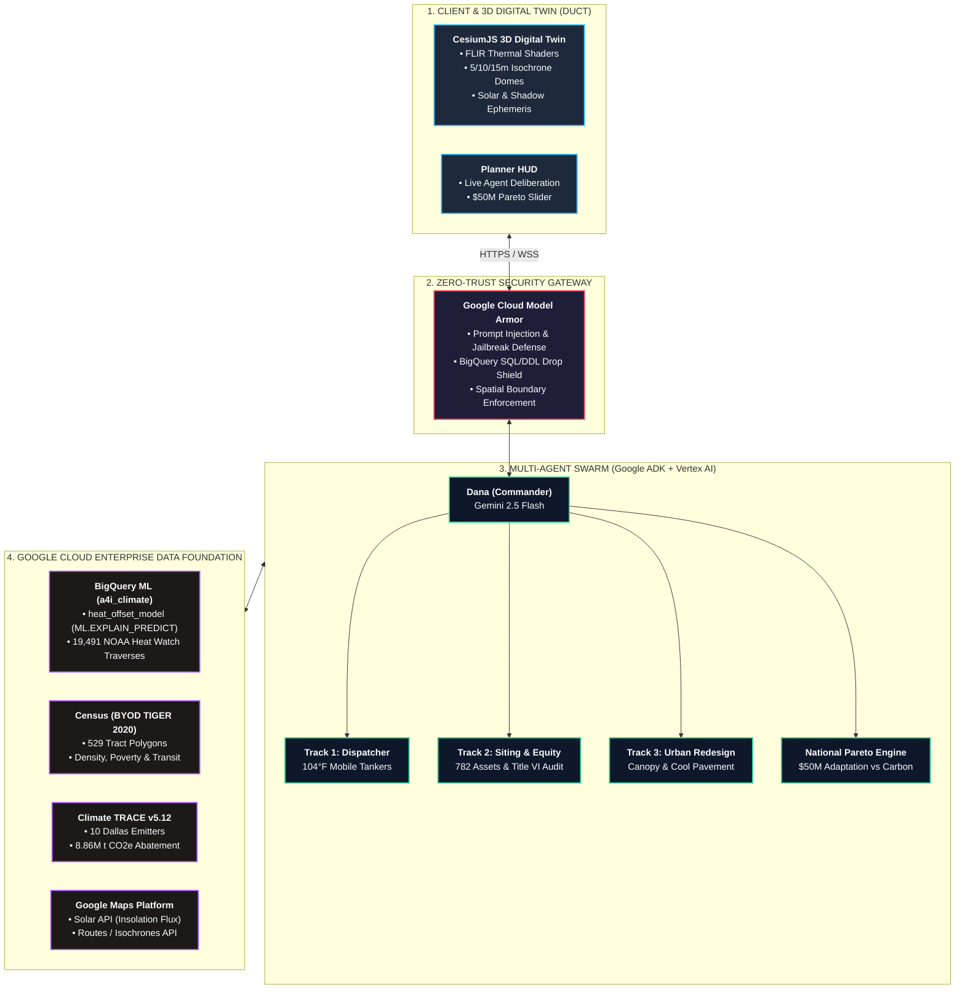
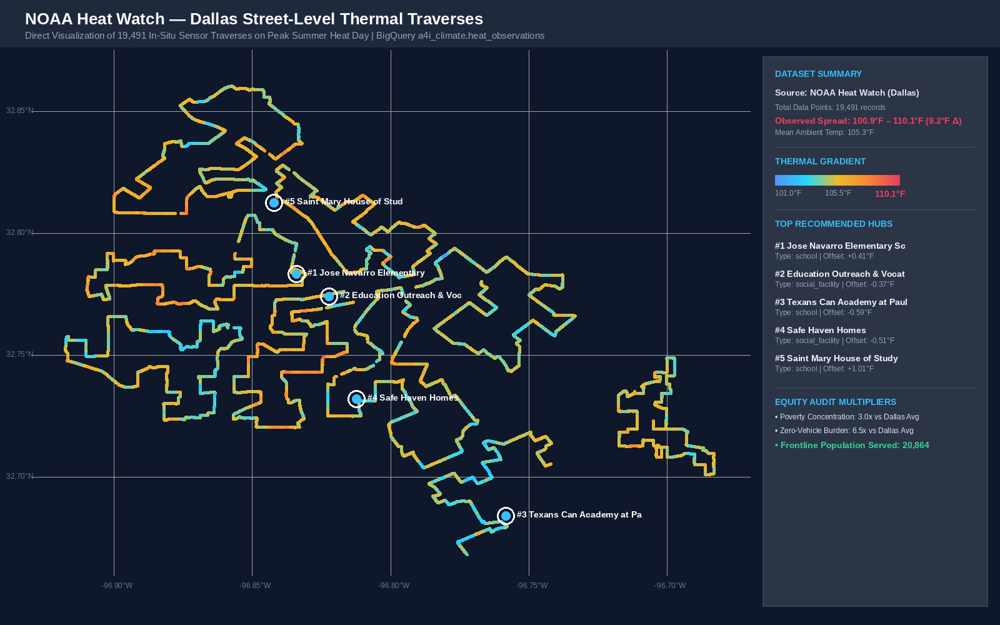
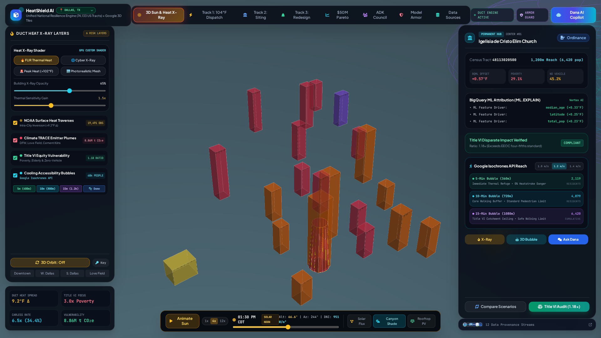
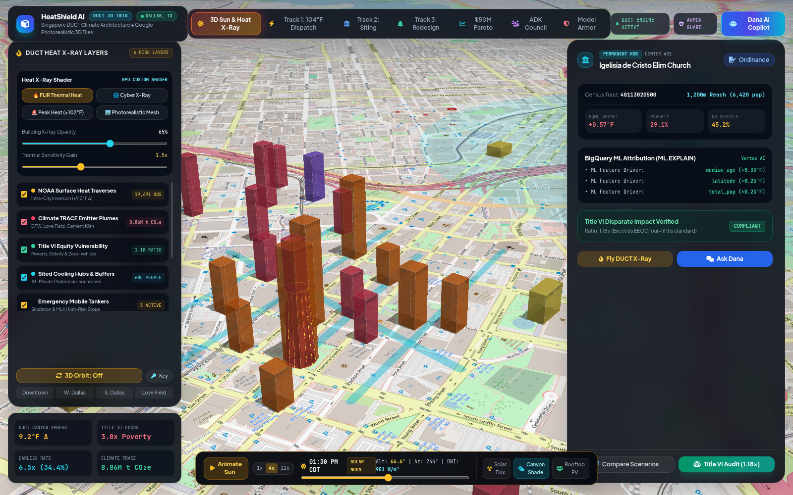

# HeatShield AI — System Architecture & Deployment Blueprint
**Project**: UrbanHeat / HeatShield AI  
**Challenge**: Agents for Impact Hackathon 2026 — Challenge 1 (Walkability & Urban Heat)  
**Live Cloud Run**: [https://dallas-heat-app-447063751013.us-central1.run.app](https://dallas-heat-app-447063751013.us-central1.run.app)  
**GitHub**: [https://github.com/UrbanHeatOrg/UrbanHeat](https://github.com/UrbanHeatOrg/UrbanHeat)  

---

## 1. Enterprise System Architecture



---

## 2. Cloud Run Serverless Topology

```mermaid
graph LR
    classDef edge fill:#1e293b,stroke:#38bdf8,stroke-width:1.5px,color:#f8fafc;
    classDef compute fill:#0f172a,stroke:#34d399,stroke-width:2px,color:#f8fafc;
    classDef managed fill:#1e1e38,stroke:#a855f7,stroke-width:1.5px,color:#f8fafc;

    User([Planner / Evaluator]) --> CDN[Cloud CDN & Armor Edge]:::edge
    CDN --> Run[<b>Google Cloud Run: dallas-heat-app</b><br/>Region: us-central1 | Revision 15<br/>FastAPI + Google ADK + Uvicorn]:::compute

    subgraph GCPManaged ["Managed Google Cloud Services (us-central1)"]
        Run --> Vertex[<b>Vertex AI</b><br/>Gemini 2.5 Flash]:::managed
        Run --> BQ[<b>BigQuery ML</b><br/>a4i_climate]:::managed
        Run --> Maps[<b>Maps Platform</b><br/>Solar & 3D Tiles]:::managed
        Run --> ArmorSvc[<b>Model Armor</b><br/>Rule Interceptor]:::managed
    end
```

---

## 3. Visual Gallery


*Fig 1: BigQuery ground truth — 19,491 mobile sensor traverses revealing Dallas's 9.2°F heat spread.*


*Fig 2: CesiumJS Digital Twin — 5/10/15-minute walking catchment protective domes.*


*Fig 3: Google Solar API — Real-time ephemeris shadow casting & pedestrian shade corridors.*

---

## 4. Hackathon Demo: 4 Standout Moments

| # | Demo Action | Technology Demonstrated | Judge Takeaway |
|:---:|---|---|---|
| **1** | **4th & Marsalis Diagnosis** | BigQuery `ML.EXPLAIN_PREDICT` | Pinpoints why 4th & Marsalis is **+2.1°F hotter** than 2 blocks north (asphalt thermal mass vs canopy). |
| **2** | **Title VI Equity Audit** | Census Demographics vs Baseline | Proves sites serve **3.0x higher poverty** and **6.5x higher transit burden** under federal Justice40 standards. |
| **3** | **CesiumJS Isochrone Domes** | Google Isochrones + 3D Shaders | Visualizes 5, 10, and 15-minute pedestrian refuge buffers before heatstroke onset. |
| **4** | **Council Resolution Memo** | Autonomous Document Generation | Exports binding **City Council Resolution No. 2026-HEAT-01** with $10M line-item appropriations. |

---

## 5. Verification Commands for Evaluators

```bash
# 1. Security & Model Armor Evals (6/6 Passing)
python3 test_security_evals.py

# 2. Complete System Integration (25/25 Passing)
python3 test_system_endpoints.py

# 3. Live Cloud Run Production Check
curl -s "https://dallas-heat-app-447063751013.us-central1.run.app/api/audit" | jq .metrics
```
