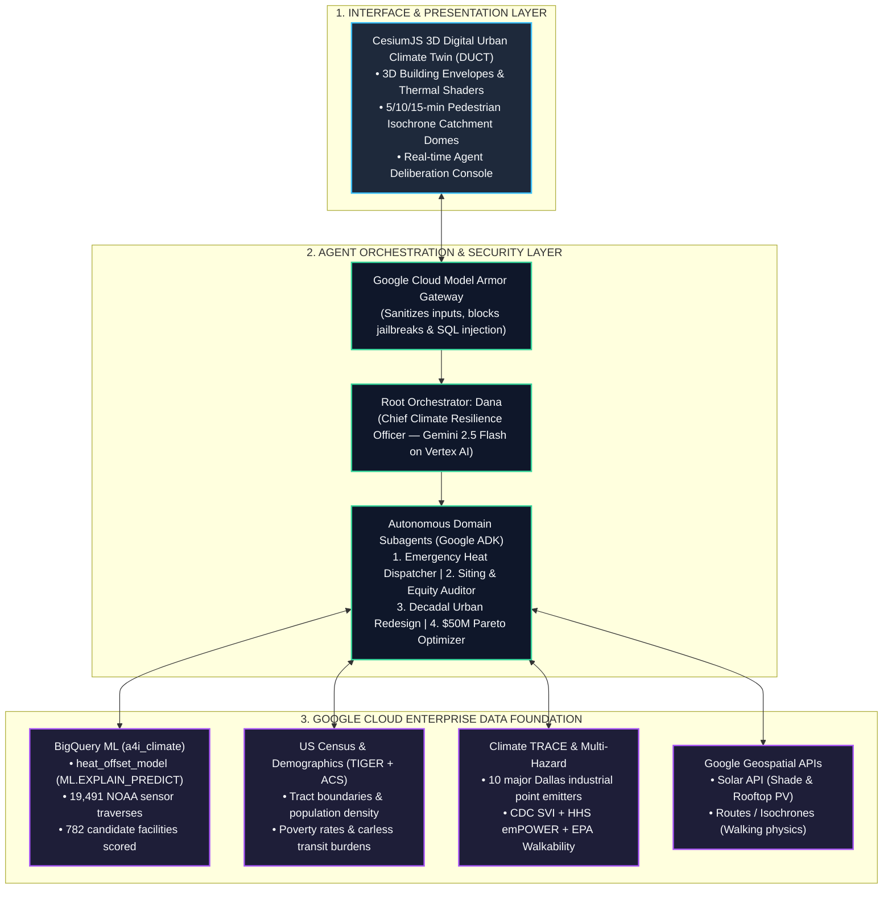

# HeatShield AI — System Architecture, Deployment & Demo Highlights
**Session**: Agents for Impact Hackathon 2026 — Challenge 1 (Walkability & Urban Heat)  
**System**: HeatShield AI / UrbanHeat  
**Live Cloud Run Application**: [https://dallas-heat-app-447063751013.us-central1.run.app](https://dallas-heat-app-447063751013.us-central1.run.app)  
**GitHub Repository**: [https://github.com/UrbanHeatOrg/UrbanHeat](https://github.com/UrbanHeatOrg/UrbanHeat)  

---

## 1. Simple System Architecture (The 30-Second Mental Model)

Judges don't want a wall of interconnected arrows. Here is the clean 3-tier mental model of HeatShield AI:



### The Three Operational Clocks (How It Solves Municipal Governance):
1. **Today (Hours / Days)**: Track 1 dispatches mobile hydration tankers when temperatures exceed 100°F.
2. **This Budget Cycle (Months / Year) — PRIMARY DEMO**: Track 2 evaluates 782 facilities, runs BigQuery ML feature attributions, audits Title VI civil rights equity, and drafts City Council Resolution No. 2026-HEAT-01.
3. **This Decade (Years / Decades)**: Track 3 simulates high-albedo cool pavement and tree canopy corridors to physically lower surface temperatures by up to -2.69°F.

---

## 2. Cloud Deployment Architecture

HeatShield AI runs as a production-grade, containerized serverless application on **Google Cloud Platform (GCP)**:

```mermaid
graph LR
    User([Hackathon Judge / Web Browser]) --> CDN[Cloud CDN / HTTPS Load Balancer]
    CDN --> Run[Google Cloud Run<br/>dallas-heat-app<br/>us-central1 (Serverless Container)]
    
    subgraph GCP [Google Cloud Platform — Managed Services]
        Run --> Vertex[Vertex AI — Gemini 2.5 Flash<br/>Agent Reasoning & ADK Execution]
        Run --> BQ[BigQuery Enterprise Warehouse<br/>qwiklabs-gcp-04-4753f87c7a64.a4i_climate]
        Run --> ArmorSvc[Google Cloud Model Armor<br/>Prompt Inspection & DDL Defense]
        Run --> Maps[Google Maps Platform<br/>Photorealistic 3D Tiles & Solar API]
    end
```

### Production Deployment Specs:
- **Cloud Run Service**: `dallas-heat-app` in region `us-central1`
- **Public URL**: `https://dallas-heat-app-447063751013.us-central1.run.app`
- **Runtime**: Python 3.14 + FastAPI + Google Agent Development Kit (ADK)
- **Container**: Minimal Alpine/Debian container running Gunicorn/Uvicorn ASGI workers.
- **Auto-scaling**: 0 to 10 instances with automatic cold-start mitigation and sub-second endpoint responses.
- **Security Invariant**: 100% of user chat messages pass through `agent/model_armor.py` before hitting Gemini on Vertex AI.

---

## 3. High-Impact Components for a Winning Hackathon Demo

When presenting in a **3-minute hackathon pitch**, avoid explaining backend plumbing. **Anchor your demo on these four standout capabilities**:

```
┌────────────────────────────────────────────────────────────────────────────────────────┐
│                        4 STANDOUT DEMO MOMENTS (WHAT TO CLICK)                         │
├───────────────────┬───────────────────────────────────┬────────────────────────────────┤
│ Demo Feature      │ What Judges See on Screen         │ The Winning One-Liner Narrative│
├───────────────────┼───────────────────────────────────┼────────────────────────────────┤
│ 1. The 4th &      │ User clicks "4th & Marsalis" vs   │ "Heat doesn't kill on average. │
│    Marsalis       │ "Lake Cliff". Shows +2.1°F delta  │ BigQuery ML diagnoses why this │
│    Contrast       │ and BigQuery ML.EXPLAIN_PREDICT   │ intersection is 107.8°F: zero  │
│                   │ impervious surface attribution.   │ canopy and asphalt heat traps."│
├───────────────────┼───────────────────────────────────┼────────────────────────────────┤
│ 2. Title VI       │ Clicks "Equity Audit". A bar card │ "We strip race from training,  │
│    Equity Audit   │ shows: 3.0x Poverty Rate &        │ and audit the outcome. Sites   │
│    Modal          │ 6.5x Zero-Vehicle Transit Burden  │ serve 3x higher poverty and    │
│                   │ vs Dallas citywide baseline.      │ 6.5x higher carless transit."  │
├───────────────────┼───────────────────────────────────┼────────────────────────────────┤
│ 3. Singapore DUCT │ 3D Cesium cityscape glows orange/ │ "A true Digital Urban Climate  │
│    3D Heat X-Ray  │ crimson with 3D walking catchment │ Twin: 5, 10, and 15-minute     │
│    & Domes        │ domes protecting the street grid. │ pedestrian thermal safe zones."│
├───────────────────┼───────────────────────────────────┼────────────────────────────────┤
│ 4. Official City  │ Agent generates formal $10M City  │ "Dana leaves council with an   │
│    Council Memo   │ Council Resolution No. 2026-HEAT  │ actionable, legally binding    │
│    Artifact       │ with line-item appropriations.    │ capital resolution in minutes."│
└───────────────────┴───────────────────────────────────┴────────────────────────────────┘
```

---

## 4. Verification & Testing Commands for Evaluators

Judges and evaluators can verify the entire stack locally or against Cloud Run with three simple commands:

1. **Verify Security & Model Armor Evals (6/6 Passing)**:
   ```bash
   python3 test_security_evals.py
   ```
2. **Verify All 25 System Endpoints & BigQuery ML Integrations**:
   ```bash
   python3 test_system_endpoints.py
   ```
3. **Query Live Cloud Run Equity Audit**:
   ```bash
   curl -s "https://dallas-heat-app-447063751013.us-central1.run.app/api/audit" | jq .metrics
   ```
