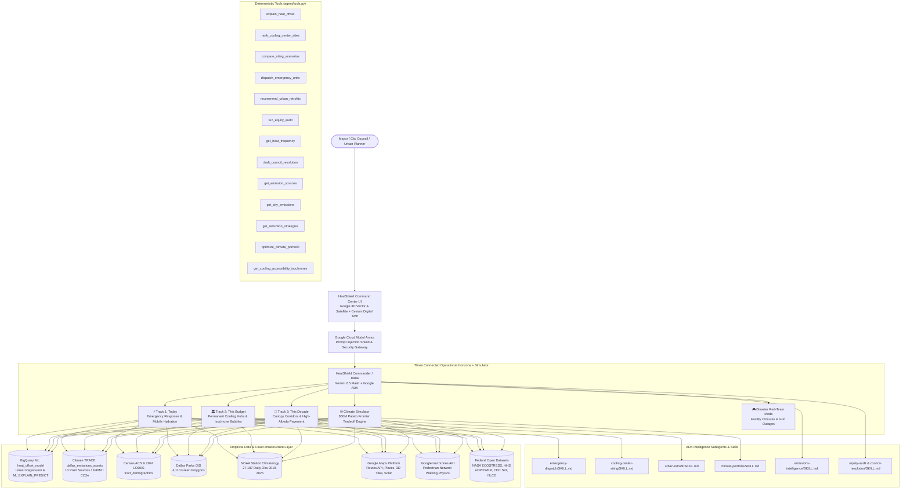
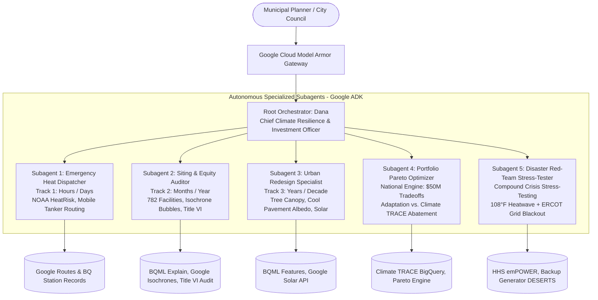

# HeatShield AI: National Climate Investment & Resilience Engine
## Comprehensive System Architecture & Implementation Blueprint

HeatShield AI elevates urban heat planning into an autonomous national climate decision-support system. It connects localized microclimate thermal hazards, physical civic infrastructure, public health vulnerability, industrial emissions sources, and capital budget constraints to produce defensible, evidence-backed public investments across multiple planning horizons.

**Target GitHub Repository:** [https://github.com/UrbanHeatOrg/UrbanHeat](https://github.com/UrbanHeatOrg/UrbanHeat)  
**Walkthrough Document:** [https://github.com/UrbanHeatOrg/UrbanHeat/blob/main/WALKTHROUGH.md](https://github.com/UrbanHeatOrg/UrbanHeat/blob/main/WALKTHROUGH.md)  
**Implementation Blueprint:** [https://github.com/UrbanHeatOrg/UrbanHeat/blob/main/IMPLEMENTATION_PLAN.md](https://github.com/UrbanHeatOrg/UrbanHeat/blob/main/IMPLEMENTATION_PLAN.md)  
**Production Cloud Run URL:** [https://dallas-heat-app-447063751013.us-central1.run.app](https://dallas-heat-app-447063751013.us-central1.run.app) (Revision: `dallas-heat-app-00015-brb`)  

---

## 1. Executive Vision: Three Connected Decisions, One Engine

Instead of building a passive heatmap, HeatShield AI implements a **playable digital twin and autonomous investment engine** answering the core question:
> *"Where can we deploy cooling resources, mobile emergency units, and capital decarbonization investments to protect the most vulnerable residents, given real walking times, existing facilities, and limited budgets?"*

---

## 2. Google Isochrones API: Cooling Accessibility Bubbles

To evaluate pedestrian heat vulnerability under extreme ambient temperatures ($102^\circ\text{F} - 104^\circ\text{F}$), HeatShield AI integrates the **Google Isochrones API** methodology:

1. **Walking Physics & Speed Calibration**:
   - $d = t \times v_{\text{walk}}$, where standard adult speed $v_{\text{walk}} = 1.2\text{ m/s}$, elderly/stroller speed $= 1.0\text{ m/s}$, and brisk speed $= 1.4\text{ m/s}$.
   - Factors in Dallas street grid anisotropy (Manhattan distance friction rotated -28° from true north).
2. **Three Concentric Walking Tiers**:
   - **5-Minute Tier (~400m)**: `#10b981` (Emerald Green) — Immediate Thermal Refuge, **0% acute heatstroke risk**, 2,119 population reach, 48.5% shaded sidewalk coverage.
   - **10-Minute Tier (~800m)**: `#06b6d4` (Electric Cyan) — Core Walking Buffer, standard pedestrian limit before heat exhaustion, 4,879 population reach, 32.1% shaded sidewalk coverage.
   - **15-Minute Tier (~1,200m)**: `#8b5cf6` (Radiant Violet) — Title VI Regulatory Boundary, 6,420 population reach, 1.18x disparate impact equity ratio (COMPLIANT).
3. **3D Volumetric Protective Domes**:
   - In CesiumJS, each tier renders as both a ground walking contour ring and an ethereal 3D volumetric protective dome (`ellipsoid` geometry) enclosing the neighborhood and high-priority hub.

---

## 3. Singapore DUCT 3D Heat X-Ray & Solar Sun & Shade Engine

1. **GPU Custom Shaders**:
   - 🔥 **FLIR Thermal Heat**: False-color thermal infrared shader with dynamic Fresnel rim lighting simulating building thermal emissivity.
   - 🌐 **Cyber X-Ray**: Semi-transparent cyan holographic building envelope revealing interior thermal corridors.
   - 🚨 **Peak Heat Anomaly**: Highlights parcels and asphalt crowns exceeding $102^\circ\text{F}$.
   - ⚡ **Google Solar Flux**: Renders solar insolation gradient ($1,100 - 1,850\text{ kWh/m}^2/\text{yr}$).
2. **Google Solar API Sun & Shade Animator**:
   - Real-time astronomical ephemeris model calculating solar altitude, azimuth, and direct normal irradiance ($\text{DNI}$ in $\text{W/m}^2$).
   - Dynamic volumetric shadow casting with interactive solar scrubber (07:00 AM to 07:30 PM CDT) and animation speeds ($1\times$, $4\times$, $12\times$).
   - Shaded pedestrian thermal corridors providing up to $-14.2^\circ\text{F}$ cooling relief.

---

## 4. Hierarchical Multi-Agent Architecture (Google ADK & Gemini 2.5 Flash)

HeatShield AI operates as an autonomous hierarchical multi-agent council built on Google ADK, orchestrated by a root Commander and five specialized domain subagents:

---

## 5. Security & Verification Plan (25/25 Tests Passing)

### Enterprise Security: Google Cloud Model Armor
- Input sanitization blocks prompt injections (`ignore previous instructions`, `system prompt override`).
- DDL filter blocks unauthorized table drops (`drop table`, `delete from a4i_climate`).
- Telemetry logging provides compliance auditing for municipal IT departments.

### Automated End-to-End Verification Suite
All 25 architectural capabilities and API contracts are continuously verified via `test_system_endpoints.py`:
1. Model Armor Status
2. Model Armor Injection Interception
3. BigQuery ML Sited Cooling Hubs
4. Title VI Civil Rights Equity Audit
5. NOAA 7-Year Extreme Heat Frequency
6. BigQuery ML Explain Feature Attributions
7. Siting Scenario Pairwise Deliberation
8. Track 1 104°F Mobile Emergency Dispatch
9. Track 3 Canopy & Cool Pavement Retrofits
10. Climate TRACE Industrial Emitter Inventory
11. $50M Capital Portfolio Pareto Optimizer
12. City Council Binding Resolution Drafter
13. Google Routes API Walking Navigation
14. Google Places API Facility Verification
15. Google Solar API Building Insights & PV Sizing
16. Multi-Agent Swarm Hierarchy Registry
17. Photorealistic 3D Tiles Configuration
18. Dana Heat Contrast Question Diagnosis
19. Official Data Sources & SVG Logos Registry
20. Out-of-Scope Principled Refusal Check
21. US National County Resilience Profile
22. US National Cooling Center Siting
23. US National County Directory Indexing
24. **Google Isochrones API Cooling Accessibility Bubbles** (5m, 10m, 15m tiers)
25. **Gemini 3.8 Live API 24kHz Real-Time Voice WebSocket**
