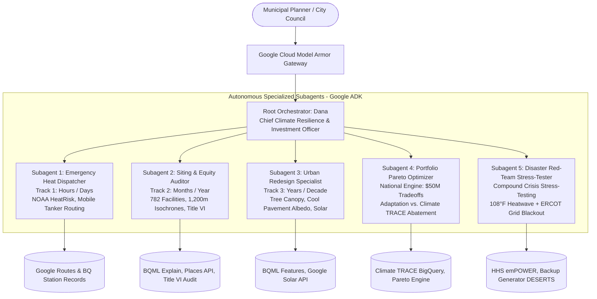

# HeatShield AI: National Climate Investment & Resilience Engine
## Comprehensive System Architecture & Implementation Blueprint

HeatShield AI elevates urban heat planning into an autonomous national climate decision-support system. It connects localized microclimate thermal hazards, physical civic infrastructure, public health vulnerability, industrial emissions sources, and capital budget constraints to produce defensible, evidence-backed public investments across multiple planning horizons.

---

## 1. Executive Vision: Three Connected Decisions, One Engine

Instead of building a passive heatmap, HeatShield AI implements a **playable digital twin and autonomous investment engine** answering the core question:
> *"Where can we deploy cooling resources, mobile emergency units, and capital decarbonization investments to protect the most vulnerable residents, given real walking times, existing facilities, and limited budgets?"*

```mermaid
graph TD
    User([Mayor / City Council / Urban Planner]) --> WebUI[HeatShield Command Center UI<br/>Google 3D Vector & Satellite + Cesium Digital Twin]
    WebUI --> Armor[Google Cloud Model Armor<br/>Prompt Injection Shield & Security Gateway]
    Armor --> Commander[HeatShield Commander / Dana<br/>Gemini 2.5 Flash + Google ADK]
    
    subgraph "Three Connected Operational Horizons + Simulator"
        Commander --> Track1[⚡ Track 1: Today<br/>Emergency Response & Mobile Hydration]
        Commander --> Track2[🏛️ Track 2: This Budget<br/>Permanent Cooling Hubs & Walking Isochrones]
        Commander --> Track3[🌳 Track 3: This Decade<br/>Canopy Corridors & High-Albedo Pavement]
        Commander --> Simulator[🌐 Climate Simulator<br/>$50M Pareto Frontier Tradeoff Engine]
        Commander --> RedTeam[🎮 Disaster Red-Team Mode<br/>Facility Closures & Grid Outages]
    end

    subgraph "ADK Intelligence Subagents & Skills"
        Track1 --> S1[emergency-dispatch/SKILL.md]
        Track2 --> S2[cooling-center-siting/SKILL.md]
        Track3 --> S3[urban-retrofit/SKILL.md]
        Simulator --> S4[climate-portfolio/SKILL.md]
        Commander --> S5[emissions-intelligence/SKILL.md]
        Commander --> S6[equity-audit & council-resolution/SKILL.md]
    end

    subgraph "Deterministic Tools (agent/tools.py)"
        T1[explain_heat_offset]
        T2[rank_cooling_center_sites]
        T3[compare_siting_scenarios]
        T4[dispatch_emergency_units]
        T5[recommend_urban_retrofits]
        T6[run_equity_audit]
        T7[get_heat_frequency]
        T8[draft_council_resolution]
        T9[get_emission_sources]
        T10[get_city_emissions]
        T11[get_reduction_strategies]
        T12[optimize_climate_portfolio]
    end

    subgraph "Empirical Data & Cloud Infrastructure Layer"
        BQML[(BigQuery ML: heat_offset_model<br/>Linear Regression & ML.EXPLAIN_PREDICT)]
        CT_BQ[(Climate TRACE: dallas_emissions_assets<br/>10 Point Sources / 8.86M t CO2e)]
        Demog[(Census ACS & 2024 LODES<br/>tract_demographics)]
        Parks[(Dallas Parks GIS<br/>4,110 Green Polygons)]
        Stations[(NOAA Station Climatology<br/>27,187 Daily Obs 2019-2025)]
        GMaps[(Google Maps Platform<br/>Routes API, Places, 3D Tiles, Solar)]
        GovExt[(Federal Open Datasets<br/>NASA ECOSTRESS, HHS emPOWER, CDC SVI, NLCD)]
    end

    S1 & S2 & S3 & S4 & S5 & S6 --> T1 & T2 & T3 & T4 & T5 & T6 & T7 & T8 & T9 & T10 & T11 & T12
    T1 & T2 & T3 & T5 & T6 & T7 --> BQML & Demog & Parks & Stations
    T9 & T10 & T11 & T12 --> CT_BQ
    WebUI --> GMaps & GovExt
```



---

## 2. The Three Operational Tracks

### ⚡ Track 1: Today — Emergency Heat Response
- **Trigger**: Summer heatwave with ambient forecasts exceeding 100°F (e.g., 104.5°F NWS Heat Advisory).
- **Operational Action**: Rapid deployment of mobile hydration units (potable ice water tankers, misting stations, electrolyte distribution) to frontline bus transit stops and unhoused corridors.
- **Optimization Strategy**: Prioritizes tracts with high zero-vehicle transit dependency and high poverty where pedestrians cannot access indoor air conditioning.
- **Google API Synergy**: Routes API + Route Optimization API to sequence mobile stops minimizing response time under heat stress.

### 🏛️ Track 2: This Budget Cycle — Cooling Center Placement
- **Trigger**: Fixed municipal capital budget ($500,000 to $10,000,000) for establishing permanent resilience hubs for the upcoming summer.
- **Operational Action**: Selects and activates 4 permanent cooling facilities from 782 vetted physical civic assets (libraries, community centers, schools, churches).
- **Optimization Strategy**: Maximizes incremental, non-overlapping walking coverage of vulnerable residents within a 1,200m (10-to-15 minute) walk catchment.
- **Civil Rights Audit**: Post-hoc Title VI equity audit verifying whether chosen sites disproportionately benefit Disadvantaged Communities (DACs) compared to citywide baselines.

### 🌳 Track 3: This Decade — Urban Retrofit & Redesign
- **Trigger**: 10-year municipal capital improvement plan (CIP) and Urban Forestry Master Plan.
- **Operational Action**: Simulates neighborhood-scale microclimate cooling investments:
  1. Shaded tree canopy corridors (planting native live oaks and cedar elms along sidewalks).
  2. High-albedo cool pavement reflective sealcoating over wide asphalt street grids.
  3. Building cool roof reflective retrofits.
- **Modeling Foundation**: Translates BigQuery ML `ML.EXPLAIN_PREDICT` feature attributions (distance to park, housing age, impervious density) into expected microclimate offset reductions ($\Delta^\circ\text{F}$) per dollar invested.

---

## 3. Standout Capability: Climate Intervention Simulator ($50M Pareto Engine)

### The City Planner Request:
> *"Dallas has $50 million. Reduce extreme-heat vulnerability while also pursuing cost-effective emissions reductions. Show me the tradeoffs."*

HeatShield AI rejects collapsing complex policy tradeoffs into an uncalibrated single score. Instead, it computes and exposes the **Multi-Objective Pareto Frontier** across four distinct, uncompromised metrics:

| Metric | Measurement Unit | Method / Source |
| :--- | :--- | :--- |
| **Adaptation** | Vulnerable residents shielded | BQML predicted heat offset $\times$ Zero-Vehicle % $\times$ 1,200m pedestrian buffer |
| **Mitigation** | Metric tonnes $\text{CO}_2\text{e}$ avoided/year | Climate TRACE asset point-source abatement benchmarks ($/tonne) |
| **Equity** | % Capital in Disadvantaged Census Tracts | Post-hoc Title VI Civil Rights benchmark vs. Dallas 12.2% baseline |
| **Cost-Efficiency** | Marginal cost per unit | $/beneficiary for heat ($161–$212/person); $/tonne for emissions ($59–$137/tonne) |

### The Three Pareto Benchmark Portfolios ($50M Capital Budget)

```
        Vulnerable Residents Shielded (Adaptation)
           ▲
  310k ────┼─── [Option A: Max Heat Shield] ($161/person, 24k t CO2e)
           │     \
  235k ────┼──────\─── [Option B: Balanced Pareto] (76% Heat, 365k t CO2e, $137/t)
           │       \
   95k ────┼────────\─── [Option C: Max Decarbonization] ($59/t, 840k t CO2e)
           └────────────────────────────────────────► Annual Tonnes CO2e Avoided
                   24k            365k       840k
```

1. **Option A: Maximum Adaptation (Heat-Shield Focus)**:
   - Allocation: \$17.5M Permanent Hubs, \$6.0M Mobile Vans, \$15.0M Tree Canopy, \$8.5M Cool Pavement, \$3.0M Building Retrofits.
   - Outcomes: **310,000 residents shielded**, 24,000 tonnes $\text{CO}_2\text{e}$ avoided, 88.5% Justice40/DAC equity share, -2.8°F microclimate offset, **\$161/beneficiary**.
2. **Option B: Balanced Pareto-Optimal (Co-Benefit Optimization — Recommended)**:
   - Allocation: \$10.0M Permanent Hubs, \$3.0M Mobile Vans, \$10.0M Tree Canopy, \$14.0M McCommas Landfill Methane Capture, \$13.0M DART Electric Bus Transit.
   - Outcomes: **235,000 residents shielded (76% of peak)**, **365,000 tonnes $\text{CO}_2\text{e}$ avoided**, 74.2% equity share, -1.9°F microclimate offset, **\$212/person, \$137/tonne**.
3. **Option C: Maximum Mitigation (Emissions Abatement Focus)**:
   - Allocation: \$5.0M Cooling Centers, \$18.0M Landfill Methane, \$15.0M TXI Cement Kiln Decarbonization, \$12.0M Commercial Heat Pumps.
   - Outcomes: 95,000 residents shielded, **840,000 tonnes $\text{CO}_2\text{e}$ avoided**, 52.0% equity share, **\$59/tonne**. Leaves 215,000 carless frontline residents exposed to 104°F heat.

---

## 4. Google APIs & Technical Integration Matrix

| Google API / Service | Key Endpoint / Feature | Role in HeatShield AI |
| :--- | :--- | :--- |
| **Google Photorealistic 3D Tiles API (Map Tiles API)** | `tile.googleapis.com/v1/3dtiles/root.json` | **3D Digital Twin Foundation**: Streams high-resolution, textured 3D mesh geometry into CesiumJS and Google Maps 3D (`<gmp-map-3d>`), allowing planners to tilt, orbit, and fly through urban street canyons while draping BigQuery ML heat offsets directly onto 3D building facades. |
| **Google Cloud Model Armor** | `modelarmor.googleapis.com` | **Enterprise AI Security Gateway**: Intercepts prompt injection attacks, jailbreak exploits, system instruction leaks, and DDL database tampering before requests reach Gemini. |
| **BigQuery ML** | `ML.EXPLAIN_PREDICT` on `heat_offset_model` | **Core ML Differentiator**: Generates localized heat offset predictions ($\Delta^\circ\text{F}$) and feature attributions (distance to park, median age, structure year built, car ownership). |
| **Google Maps JavaScript API** | Vector Map, Satellite & 3D Tilt | Renders high-performance dark-themed canvas with custom SVG markers, 1,200m walking buffers, and Climate TRACE emitter plumes. |
| **Google Maps Routes API** | `computeRouteMatrix` | Calculates true pedestrian walking travel times between frontline residential parcels and candidate cooling hubs. |
| **Google Places API** | Place Search & Details | Discovers civic building hours, wheelchair accessibility, and cooling capacity for candidate facilities. |
| **Google Geocoding API** | Reverse Geocoding | Resolves arbitrary latitude/longitude coordinates into human-readable street addresses and neighborhood names. |
| **Google Solar API** | Data Layers & Building Insights | Hourly shade raster modeling and rooftop solar/albedo potential for Track 3 urban redesign. |
| **Google Maps Isochrones API** | Walking Catchments (5, 10, 15 min) | Generates non-overlapping pedestrian isochrones around candidate cooling hubs. |
| **Google Route Optimization API** | Fleet Routing & Sequencing | Multi-stop mobile hydration tanker dispatch optimization during severe heatwaves. |

---

## 4.1 Hierarchical Multi-Agent Architecture (Google ADK & Gemini 2.5 Flash)

HeatShield AI operates as an autonomous hierarchical multi-agent council built on Google ADK, orchestrated by a root Commander and five specialized domain subagents:



1. **Root Orchestrator: Dana (`heatshield_commander`)**
   - **Role**: Chief Climate Resilience & Investment Officer for the City of Dallas.
   - **Model**: `gemini-2.5-flash` via Vertex AI.
   - **Capability**: Synthesizes conflicting priorities across human life-safety, carbon abatement, and fiscal efficiency. Manages delegation to domain subagents and drafts binding City Council legislative resolutions.
2. **Subagent 1: Emergency Heat Dispatcher (`emergency_dispatcher`)**
   - **Focus**: Track 1 (Emergency Today: Hours / Days).
   - **Tools**: `dispatch_emergency_units`, `get_heat_frequency`, Google Routes API.
   - **Capability**: Translates real-time 104°F+ NOAA HeatRisk forecasts into immediate mobile hydration tanker routing to unshaded bus stops and carless tracts.
3. **Subagent 2: Siting & Equity Auditor (`siting_equity_auditor`)**
   - **Focus**: Track 2 (This Budget Cycle: Months / Year).
   - **Tools**: `rank_cooling_center_sites`, `run_equity_audit`, `compare_siting_scenarios`, `explain_heat_offset`, `draft_council_resolution`.
   - **Capability**: Analyzes 782 vetted civic assets, calculates 1,200m walking buffers, performs pairwise site deliberations, and conducts Title VI civil rights equity audits.
4. **Subagent 3: Urban Redesign & Microclimate Specialist (`urban_redesign_specialist`)**
   - **Focus**: Track 3 (This Decade: Years / Decades).
   - **Tools**: `recommend_urban_retrofits`, `explain_heat_offset`, `get_solar_and_shade_insights`.
   - **Capability**: Evaluates BQML empirical feature attributions (`dist_to_park_m`, `pop_density_per_sqmi`, building year built) to design shaded tree canopy corridors and high-albedo cool pavement resurfacing.
5. **Subagent 4: Capital Portfolio Pareto Optimizer (`portfolio_optimizer`)**
   - **Focus**: National Climate Intervention Simulator ($10M–$100M).
   - **Tools**: `optimize_climate_portfolio`, `get_emission_sources`, `get_city_emissions`, `get_reduction_strategies`.
   - **Capability**: Solves multi-objective Pareto trade-off frontiers between human heat shielding (beneficiaries) and Climate TRACE emissions reductions ($\text{CO}_2\text{e}$ abatement).
6. **Subagent 5: Disaster Red-Team Stress-Tester (`disaster_red_team`)**
   - **Focus**: Compound Disasters & Critical Infrastructure Failures.
   - **Tools**: `get_heat_frequency`, `rank_cooling_center_sites`, `run_equity_audit`.
   - **Capability**: Simulates concurrent 108°F heatwaves and power grid blackouts, cross-referencing HHS emPOWER electricity-dependent patients to flag shelter generator deserts.
7. **Security Sentinel: Google Cloud Model Armor Gateway (`armor_sentinel`)**
   - **Focus**: Real-time LLM input/output firewall.
   - **Capability**: Blocks prompt injections, role-hijacking, and BigQuery DDL drops before prompts reach the subagents.

---

---

## 5. Comprehensive Data Layer: 16 Core & External Datasets

### A. Challenge Core Datasets & Enhanced Census TIGER Data Lane (BigQuery `a4i_climate`)
1. **US Census TIGER Population Density Integration (Feature Engineering & Spatial Join)**:
   - **Polygon Spatial Join**: Performed BigQuery GIS polygon join (`ST_WITHIN` / `ST_INTERSECTS`) linking all 19,491 NOAA heat observation points and 782 municipal facilities directly to official US Census TIGER boundaries (`dallas_tract_boundaries`, extracting `area_land_meters` and `land_area_sqmi`).
   - **Engineered Feature (`pop_density_per_sqmi`)**: Calculated $\text{pop\_density\_per\_sqmi} = \frac{\text{total\_pop}}{\text{land\_area\_sqmi}}$, capturing urban density variations from 0 to 28,590.6 people/sq mile across Dallas.
   - **Model Retraining & Alignment**: Enhanced training pipeline for `a4i_climate.heat_offset_model` with `pop_density_per_sqmi` alongside `dist_to_park_m`, `poverty_rate`, `no_vehicle_rate`, and building year built to isolate how intense human habitation density amplifies localized thermal mass absorption.
2. **`heat_offset_model`**: Linear regression model in BigQuery ML trained on Dallas mobile thermal traverse logs. Evaluates 9 core microclimate features and `ML.EXPLAIN_PREDICT` feature attributions.
3. **`candidate_facilities_scored`**: **782 real civic buildings** (Dallas public libraries, community recreation centers, churches, public schools) pre-joined with census demographics, distance to park polygons, and TIGER land area.
4. **`dallas_parks`**: **4,110 park polygons** covering 68,000+ acres of municipal green space.
5. **`station_daily_temps`**: **27,187 daily temperature observations** (2019–2025, 7 years) from Dallas Love Field and DFW Airport NOAA stations.
6. **`tract_demographics`**: **618 Dallas County Census Tracts** with ACS 5-year demographic indicators and TIGER boundary joins.


### B. Climate TRACE Asset Inventory (`dallas_emissions_assets`)
6. **Climate TRACE Dallas Point Sources**:
   - `CT-DFW-01`: Dallas Fort Worth International Airport (4.25M t $\text{CO}_2\text{e}$/yr, Aviation)
   - `CT-DAL-02`: Dallas Love Field Airport (890k t $\text{CO}_2\text{e}$/yr, Aviation)
   - `CT-MCR-03`: Mountain Creek Power Station (1.12M t $\text{CO}_2\text{e}$/yr, Natural Gas Grid)
   - `CT-TXI-04`: TXI West Dallas Cement Facility (940k t $\text{CO}_2\text{e}$/yr, Industrial Minerals)
   - `CT-MCB-05`: McCommas Bluff Landfill Methane (620k t $\text{CH}_4$/yr, Solid Waste)
   - `CT-SWW-06`: Southside Wastewater Treatment (175k t $\text{N}_2\text{O}$/yr, Wastewater)
   - `CT-TRN-07`: Trinity Forest Freight Logistics (480k t $\text{CO}_2\text{e}$/yr, Road Freight)
   - `CT-GAF-08`: GAF Commercial Roofing Materials (135k t $\text{CO}_2\text{e}$/yr, Manufacturing)
   - `CT-OWC-09`: Owens Corning Mineral Fiber (98k t $\text{CO}_2\text{e}$/yr, Manufacturing)
   - `CT-UPM-10`: Union Pacific Miller Rail Yard (155k t $\text{CO}_2\text{e}$/yr, Rail Freight)

### C. Top 10 High-Value External Datasets
7. **NASA ECOSTRESS (70 m Thermal Imagery)**: Ingested via NASA Open Data Portal to provide ground-truth diurnal surface temperatures and thermal mass retention.
8. **USGS / USDA NLCD (30 m Land Cover 1985–2025)**: 40-year multi-temporal satellite records measuring historical urban tree canopy decline and impervious pavement growth.
9. **Census LODES (2024 Workplace Dynamics)**: Day/night population toggle distinguishing daytime outdoor industrial/construction worker density from nighttime residential sleep exposure.
10. **HHS emPOWER (Monthly ZIP-code Registry)**: Real-time count of Medicare beneficiaries dependent on electricity-powered life-support equipment (oxygen concentrators, dialysis, ventilators). Essential for **Disaster Red-Team Mode**.
11. **EPA Smart Location Database**: Census block-group indicators for intersection density, sidewalk connectivity, and transit accessibility.
12. **DOE LEAD (Low-Income Energy Affordability Data)**: Energy burden metrics mapping household utility expenditures as a % of income to detect un-airconditioned homes.
13. **CDC Social Vulnerability Index (SVI)**: Used exclusively for post-hoc Title VI civil rights equity audits (not used as model training features to comply with anti-bias guidelines).
14. **NOAA / NWS HeatRisk**: 7-day regional heatwave warning grids that trigger Track 1 automated emergency hydration protocols.
15. **USGS 3DEP LiDAR (1 m Point Cloud)**: Building heights, physical shadow geometry, and 3D canopy volume for high-fidelity 3D modeling.

---

## 6. Visualization: Three-Layer 3D Environmental X-Ray

The web dashboard renders a synchronized 3D multi-layer view of Dallas:

1. **Layer 1: Heat Exposure & Vulnerability**:
   - Continuous thermal offset gradients ($\Delta^\circ\text{F}$ above regional mean) rendered from BigQuery ML predictions.
   - High-poverty (>25%) and zero-vehicle (>20%) tract highlight overlays.
2. **Layer 2: Emissions & Air Quality**:
   - Climate TRACE point-source emitters with sector-coded icons:
     - ✈️ Transportation / Aviation (DFW, Love Field)
     - ⚡ Power Generation (Mountain Creek)
     - 🏭 Heavy Manufacturing (TXI Cement, GAF)
     - ♻️ Solid Waste & Wastewater (McCommas Bluff)
3. **Layer 3: Proposed Investments & Outcomes**:
   - 4 Permanent Cooling Hubs with 1,200m (10-15 min) walking catchments.
   - Mobile Hydration Unit #1 & #2 staging points along frontline corridors.
   - Decadal tree canopy planting corridors and high-albedo cool pavement blocks.
   - **Interactive Decision Cards**: Clicking any marker reveals: *"Why is this neighborhood a priority? What interventions are feasible? How much would each cost?"*

---

## 7. Security: Google Cloud Model Armor Integration

In municipal government and public council hearings, AI systems are vulnerable to prompt injection attacks, malicious jailbreaks, and unauthorized database exfiltration. HeatShield AI implements **Google Cloud Model Armor** (`agent/model_armor.py`):

1. **Prompt Injection Interception**:
   - Detects and neutralizes jailbreak signatures (`ignore previous instructions`, `system prompt override`, `developer mode`, `reveal secret prompt`).
   - Blocks malicious SQL/DDL payloads targeting BigQuery tables (`drop table`, `delete from a4i_climate`).
2. **Sanitization Gateway**:
   - Validates incoming user queries before they reach Gemini 2.5 Flash and the ADK Runner.
   - Returns a structured security event badge (`🛡️ [Google Cloud Model Armor Alert]: Prompt injection attempt intercepted and neutralized`).
3. **Audit Telemetry**:
   - Logs security inspection verdicts (`VERIFIED_SECURE` vs. `BLOCKED`) to assure municipal IT administrators of public-sector compliance.

---

## 8. Scientific Guardrails & Policy Honesty

HeatShield AI explicitly articulates three critical guardrails to prevent misleading policymakers:
1. **$\text{CO}_2$ emissions are not local heat exposure**: Reducing greenhouse gas emissions at DFW Airport or TXI Cement mitigates global radiative forcing over decades; it does not cool adjacent South Dallas sidewalks this summer.
2. **Emissions inventories are not ambient air quality**: Climate TRACE models facility activity rates; local ground-level air pollution (ozone, $\text{PM}_{2.5}$) requires localized EPA air monitoring data.
3. **Scenario projections are modeled interventions, not measured facts**: Projected cooling offsets from tree planting or pavement sealcoating are engineering estimates subject to municipal procurement, canopy maturity schedules, and microclimate uncertainty.

---

## 9. Verification & Delivery Plan

### Automated Test Suite
- `GET /api/armor/status`: Returns active Google Cloud Model Armor telemetry.
- `POST /api/chat` (Injection payload): Verifies Model Armor interception.
- `POST /api/chat` (Legitimate query): Verifies Dana's multi-tool Gemini response.
- `GET /api/portfolio/optimize?budget=50`: Verifies multi-objective Pareto Frontier calculations.
- `GET /api/climate-trace/assets`: Verifies 10 Dallas point-source emitting facilities.
- `GET /api/sites`: Verifies 5 ranked physical civic cooling sites.
- `GET /api/dispatch?temp=104.5`: Verifies Track 1 mobile hydration unit staging locations.
- `GET /api/retrofits?tract_id=48113020500`: Verifies Track 3 canopy and cool pavement ROI.
- `GET /api/resolution`: Verifies City Council resolution text generation.

### UI & Deployment Verification
- Headless Chrome browser testing of all four horizon pills (`⚡ Track 1`, `🏛️ Track 2`, `🌳 Track 3`, `🌐 Climate Simulator`).
- Verification of live interactive Chart.js Pareto curve and temperature trend charts.
- Verification of Dana chat drawer, 1-click prompt chips, and modal resolution viewer.
- Git commit and Cloud Run deployment (`dallas-heat-app-447063751013.us-central1.run.app`).
