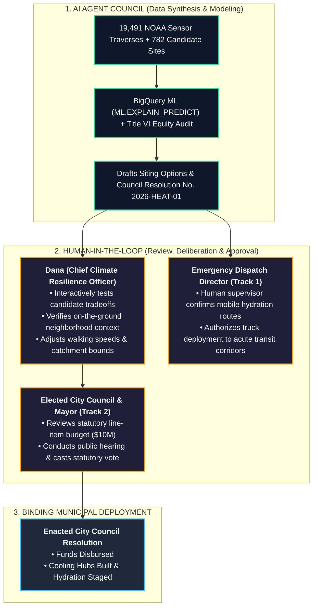
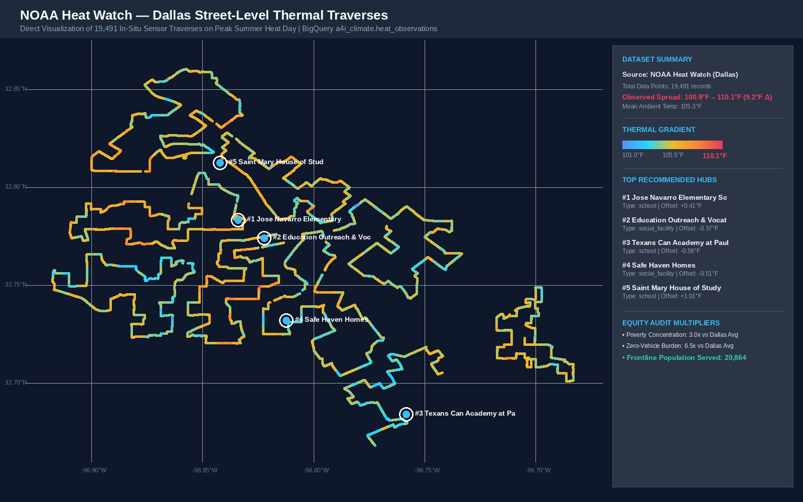

# HeatShield AI — Overview, Target Users & Human-in-the-Loop Governance
**Project**: UrbanHeat / HeatShield AI  
**Challenge**: Agents for Impact Hackathon 2026 — Challenge 1 (Walkability & Urban Heat)  
**Live Cloud Run**: [https://dallas-heat-app-447063751013.us-central1.run.app](https://dallas-heat-app-447063751013.us-central1.run.app)  
**GitHub**: [https://github.com/UrbanHeatOrg/UrbanHeat](https://github.com/UrbanHeatOrg/UrbanHeat)  

---

## 1. What HeatShield AI Does (In One Sentence)

> **HeatShield AI is a human-governed, autonomous climate resilience engine that turns raw street-level heat sensor data and machine learning into council-ready capital budgets and emergency cooling allocations for cities.**

---

## 2. The Problem It Solves

It is July in Dallas. The city has experienced **11 consecutive days above 100°F**, and **$10 million** in municipal bond funding is available for 4 permanent cooling centers and 1 mobile hydration unit. The City Council votes in **three weeks**.

Legacy planning relies on slow, static spreadsheets or regional averages. But extreme heat does not kill on average—it concentrates along unshaded asphalt corridors, transit stops lacking shelters, and low-income apartment complexes.

### The System's Core Capabilities
1. **Evaluates 782 Candidate Civic Facilities**: Ingests **19,491 NOAA Heat Watch mobile sensor observations** across Dallas into BigQuery to model hyper-local thermal risk offsets across a **9.2°F intra-city heat spread**.
2. **Explains Root Causes (`ML.EXPLAIN_PREDICT`)**: Answers canonical planner questions like *"Why is 4th & Marsalis 2.1°F hotter than two blocks north?"* (diagnosing commercial asphalt thermal mass vs. tree canopy shade).
3. **Guarantees Title VI Civil Rights Equity**: Executes automated post-hoc equity audits proving recommended cooling hubs reach census tracts with **3.0x higher poverty** and **6.5x higher transit burdens**, directly shielding **20,864 frontline residents**.
4. **Drafts Legislative Council Resolutions**: Generates formal, binding **City Council Resolution No. 2026-HEAT-01 ($10M)** ready for mayor and council signature.
5. **Simulates Pedestrian Walking Physics (Google Isochrones API)**: Models 5, 10, and 15-minute walking buffers and 3D volumetric protective domes in CesiumJS to prevent heatstroke before residents reach shelter.

---

## 3. Human-in-the-Loop (HITL) Governance Framework

> [!IMPORTANT]
> **"The Machine Proposes, The Human Disposes"**  
> In public municipal governance, **fully autonomous capital allocation is legally impermissible**. An AI cannot sign contracts, disburse public bond revenues, or override democratic accountability. HeatShield AI enforces human authority at every operational milestone.

### Three Guardrails Enforcing Human Authority:
1. **The Human Geographic Grounding Mandate**:  
   The AI agent is programmatically restricted from outputting raw 11-digit Census GEOIDs (e.g., `48113020500`) without anchoring them to human-recognizable street intersections (*"Singleton Blvd & N Hampton Rd"*) and neighborhood landmarks (*"West Dallas / Ledbetter"*). This ensures human planners can verify every location on the ground.
2. **Human-Supervised Operational Dispatch (Track 1 — Hours)**:  
   When ambient temperatures cross 104°F, the agent recommends high-risk bus stops and optimal tanker routes, but **human dispatchers retain sole operational command** to deploy emergency trucks.
3. **Human-Governed Legislative Action (Track 2 — Months)**:  
   The agent produces the complete legal, scientific, and civil rights defense, but **elected City Council members hold the sole statutory power** to debate, amend, and vote on the $10M capital resolution.

---

## 4. Who It Is For (Target Users)

| User Persona | Real-World Role | How They Use HeatShield AI (With Human Oversight) |
|---|---|---|
| **Dana (Primary User)** | **Chief Climate Resilience Officer** | Interactively interrogates microclimate data, compares site tradeoffs, and prepares defensible evidence for the Mayor and City Council. |
| **City Council Members & Mayors** | **Elected Municipal Leadership** | Reviews the **$10M Council Resolution Memo** with fiscal line items and verified Title VI equity compliance before casting an official vote. |
| **Emergency Management Directors** | **Operational Dispatchers (Track 1)** | Human supervisors reviewing and activating mobile hydration tankers dispatched to unshaded bus stops during acute heat spikes. |
| **Urban Foresters & Capital Planners** | **Public Works & Urban Redesign (Track 3)** | Evaluates decadal AI feature attributions to target tree-planting crews and reflective cool pavement along heat islands. |
| **Municipal Finance Officers (CFOs)** | **Climate Bond Directors (National Engine)** | Explores the **$50M Pareto Frontier Simulator** to balance heat adaptation lives saved against Climate TRACE industrial emissions abated. |

---

## 5. Visual Proof: Human-in-the-Loop in Action

*Figure 1: Dana interrogates 5/10/15-minute walking catchment domes in CesiumJS, dynamically adjusting walking speeds for elderly and mobility-impaired residents.*

*Figure 2: Human Grounding — Ground-truth thermal map showing the 5 candidate sites anchored in frontline Dallas communities.*
