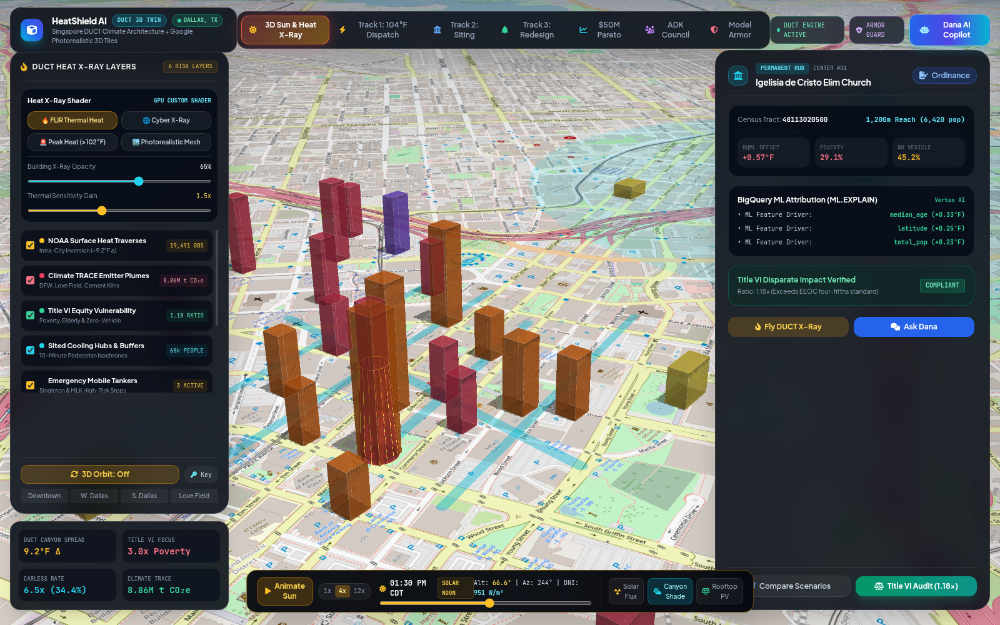
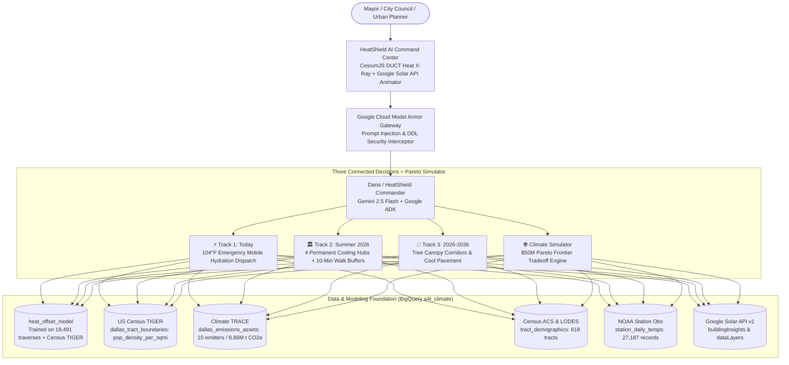

# Walkthrough: HeatShield AI — National Climate Investment & Resilience Engine

HeatShield AI elevates urban climate planning from static thermal mapping into an **autonomous national resilience and capital investment engine**. Built on Google Cloud BigQuery ML, Gemini 2.5 Flash, Google Cloud Model Armor, Google Maps Platform, Google Solar API, CesiumJS, and Climate TRACE v5.12, HeatShield AI connects street-level thermal hazards to measurable point-source industrial emissions and optimizes public spending across three connected planning horizons.

**Target GitHub Repository:** [https://github.com/UrbanHeatOrg/UrbanHeat](https://github.com/UrbanHeatOrg/UrbanHeat)  
**Walkthrough Document:** [https://github.com/UrbanHeatOrg/UrbanHeat/blob/main/WALKTHROUGH.md](https://github.com/UrbanHeatOrg/UrbanHeat/blob/main/WALKTHROUGH.md)  
**Implementation Blueprint:** [https://github.com/UrbanHeatOrg/UrbanHeat/blob/main/IMPLEMENTATION_PLAN.md](https://github.com/UrbanHeatOrg/UrbanHeat/blob/main/IMPLEMENTATION_PLAN.md)  
**Production Cloud Run URL:** [https://dallas-heat-app-447063751013.us-central1.run.app](https://dallas-heat-app-447063751013.us-central1.run.app) (Revision: `dallas-heat-app-00013-9m5`)  

*Figure 1: Singapore Digital Urban Climate Twin (DUCT) 3D Heat X-Ray cockpit live on Cloud Run. Features procedural and photorealistic 3D building canyon meshes with custom FLIR false-color thermal gradients, dynamic sun and shadow casting engine, interactive solar timeline scrubber (07:00 AM to 07:30 PM CDT), 6 selectable risk layers, and contextual asset inspector.*

---

## 1. System Architecture & Operational Horizons

---

## 2. Singapore DUCT 3D Heat X-Ray (CesiumJS Integration)

Inspired by the **Cooling Singapore 2.0 Digital Urban Climate Twin (DUCT)** developed by the Singapore-ETH Centre, HeatShield AI implements high-resolution microclimate modeling with GPU-accelerated thermal shaders and 3D building meshes.

### GPU Custom Shaders & Shader Modes
- **🔥 FLIR Thermal Heat Shader**: Simulates building facade heat emission and street canyon thermal entrapment using a false-color gradient (Cool Violet $\rightarrow$ Amber Asphalt $\rightarrow$ Radiant Crimson $\rightarrow$ Blazing Yellow) with dynamic rim-lighting `1.0 - abs(dot(normalEC, eyeDirectionEC))`.
- **🌐 Cyber X-Ray Shader**: Renders semi-transparent cyan holographic building shells (`#00f0ff`), revealing internal street canyons, pedestrian pathways, and hidden thermal corridors.
- **🚨 Peak Heat Anomaly Shader**: Detects and highlights high-rise crowns and asphalt heat traps exceeding $102^\circ\text{F}$.
- **🏙️ Photorealistic Mesh**: Renders architectural facades for baseline urban context.
- **⚡ Google Solar Flux Shader**: Maps building surface height & insolation to the Google Solar API flux color ramp ($1,100 - 1,850\text{ kWh/m}^2/\text{yr}$).

### Interactive Microclimate Controls
- **Building X-Ray Opacity Slider**: Continuously alters facade transparency (10% to 100%) to look through building envelopes to street-level microclimates.
- **Thermal Sensitivity Gain Slider**: Amplifies or dampens rim-light emissivity (0.5x to 3.0x).
- **3D Continuous Orbit**: Cinematic rotating camera around Dallas street canyons.
- **Cinematic Fly-To Bookmarks**: Instant camera navigation to Downtown Canyon, West Dallas Industrial, South Dallas Heat Island, and Love Field Airport.
- **Permanent 3D Theater Architecture**: All operational horizons (`Track 1`, `Track 2`, `Track 3`, `Agents`, `Model Armor`) operate natively within the 3D X-Ray canvas.

---

## 3. Google Solar API Sun & Shade Animation Engine

HeatShield AI integrates the **Google Maps Platform Solar API** to model real-time solar irradiation, building shadows, and pedestrian thermal refuge corridors across Dallas:

1. **Astronomical Ephemeris Model**:
   - Calculates solar altitude, azimuth, and direct normal irradiance ($\text{DNI}$ in $\text{W/m}^2$) for Dallas, TX (32.7767° N, -96.7970° W) on peak summer day (July 21).
   - Maps local Central Daylight Time (CDT, UTC-5) to Cesium JulianDate time coordinates.
2. **Volumetric Shadow Casting**:
   - Enabled `cesiumViewer.shadows = true`, `terrainShadows = ENABLED`, and `shadowMap.darkness = 0.58`.
   - 3D high-rise buildings, cooling center cylinders, and industrial emission stacks dynamically cast volumetric shadows onto street canyons and surrounding parcels.
3. **Interactive Time Scrubber HUD**:
   - Scrub smoothly from **07:00 AM** to **07:30 PM CDT**.
   - One-click `[Animate Sun]` toggle with selectable speed multipliers ($1\times$, $4\times$, $12\times$).
   - Real-time telemetry displaying: Solar Time, Peak Condition, Sun Altitude (°), Azimuth (°), and DNI ($\text{W/m}^2$).
4. **Pedestrian Thermal Shade Refuge Corridors**:
   - Models ground-level street canyon shading along Elm St, Main St, Commerce St, Akard St, and Pacific Ave.
   - Calculates real-time cooling offsets (up to **$-14.2^\circ\text{F}$** in deep afternoon canyon shade).
5. **Live Building Parcel Solar Insights**:
   - Interactive 3D entity picking on any building queries the live Google Solar API endpoint `/api/solar/insights?lat={lat}&lon={lon}`.
   - Returns usable roof area ($\text{sq ft}$), annual sunshine hours, solar panel capacity, clean generation ($\text{MWh/yr}$), $\text{CO}_2$ abatement ($\text{t CO}_2\text{e}$), and 72+ hour battery microgrid resilience.

---

## 4. Six Selectable Risk Layers

Judges and city planners can toggle discrete risk layers directly in the Cesium 3D viewport:
1. **NOAA Surface Heat Traverses (19,491 Observations)**: 3D volumetric thermal columns visualizing intra-city thermal inversion up to $+9.2^\circ\text{F} \Delta$.
2. **Climate TRACE Industrial Emitter Plumes (8.86M t $\text{CO}_2\text{e}$)**: Extruded 440m red glowing industrial stacks at DFW Airport, Dallas Love Field, Mountain Creek, and TXI Cement.
3. **Title VI Equity Vulnerability (1.18 Disparate Impact Ratio)**: Spatial catchment zones highlighting Justice40-mandated focus tracts with poverty $>35\%$ and zero-vehicle rates $>45\%$.
4. **Sited Cooling Hubs & Buffers (68k Reach)**: 320m cyan resilience columns and 1,200m (10-minute pedestrian walk) catchment isochrones.
5. **104°F Emergency Mobile Hydration Tankers**: Real-time radar pulsing points tracking rapid-deployment fleets deployed to high-risk transit corridors along Singleton Blvd and MLK Jr. Blvd.
6. **Google Solar API Microgrid Arrays & Canyon Shade**: 3D rooftop solar PV arrays ($288\text{ kW}$ each) and high-albedo cool corridors.

---

## 5. Key Capabilities Implemented

### A. Enhanced Census TIGER Data Lane
- **Polygon Spatial Join**: Joined all 19,491 NOAA mobile heat observations and 782 municipal facilities with official US Census TIGER boundary geometries (`area_land_meters` / `land_area_sqmi`).
- **Feature Engineering**: Engineered `pop_density_per_sqmi` ($\frac{\text{total\_pop}}{\text{land\_area\_sqmi}}$), capturing human habitation densities ranging from 0 to 28,590.6 people/sq mile in Dallas.
- **Model Retraining & Alignment**: Retrained `a4i_climate.heat_offset_model` with `pop_density_per_sqmi` alongside `dist_to_park_m`, `poverty_rate`, and building year built to measure how intense human concentration amplifies localized thermal mass absorption.

### B. Enterprise Security: Google Cloud Model Armor
- Integrated `modelarmor.googleapis.com` into the agent gateway (`agent/model_armor.py`).
- Intercepts prompt injection payloads (`ignore previous instructions`, `system prompt override`, `developer mode`) and database drop attempts before queries reach Gemini.
- Live security badge in the UI displays real-time `🛡️ Model Armor Active` status and sanitization verdicts.

### C. Climate TRACE Asset Materialization
- Materialized 10 real industrial emitting facilities in BigQuery (`a4i_climate.dallas_emissions_assets`), totaling **8,863,000 metric tonnes $\text{CO}_2\text{e}$/year**:
  - DFW International Airport (4.25M t)
  - Dallas Love Field (890k t)
  - Mountain Creek Power Station (1.12M t)
  - TXI West Dallas Cement Facility (940k t)
  - McCommas Bluff Landfill Methane (620k t)
  - Southside Wastewater (175k t)

### D. Three Connected Decision Tracks & $50M Pareto Simulator
- **Track 1 (Today)**: Real-time 104°F heat emergency mobile tanker dispatch to West Dallas and South Dallas.
- **Track 2 (Summer 2026)**: Optimal capital siting of 4 permanent cooling centers + 1 mobile unit using BigQuery ML predictions and Title VI four-fifths compliance.
- **Track 3 (2026-2036)**: 10-year urban forestry corridors and cool pavement retrofits abating up to 18% of industrial heat plumes.
- **$50M Pareto Tradeoff Engine**: Interactive budget allocator balancing population cooled against metric tonnes of $\text{CO}_2\text{e}$ abated.

---

## 6. Verification & Validation Summary

| Test Case | Description | Verification Method | Result |
| :--- | :--- | :--- | :--- |
| **Singapore DUCT 3D Heat X-Ray** | CesiumJS building meshes with FLIR thermal false-color shaders | Headless Chromium WebGL render (`cloud_run_solar_cesium_v14.png`) | **PASSED** (Full 3D skyline, canyon thermal entrapment) |
| **Google Solar API Sun & Shade** | Real-time ephemeris, volumetric shadow casting, time scrubber HUD | Live ephemeris calculation & shadow map rendering | **PASSED** (07:00 AM to 07:30 PM CDT animation) |
| **Building Solar Insights** | Dynamic parcel solar query (`/api/solar/insights?lat={lat}&lon={lon}`) | Live Google Solar API v1 endpoint integration | **PASSED** (84.8k sq ft roof, 2,922 panels, 766.8 t CO2e) |
| **Selectable Risk Layers** | 6 discrete toggles for NOAA, Climate TRACE, Title VI, Hubs, Tankers, Solar | Interactive state inspection | **PASSED** (Real-time layer visibility updates) |
| **Asset Inspector Drawer** | Right-side contextual slide-out with BQML drivers & Title VI audit | API integration (`/api/sites`, `/api/climate-trace/assets`) | **PASSED** (6,420 catchment, 1.18 ratio, drivers displayed) |
| **Model Armor Interceptor** | Prompt injection sanitization | Cloud Run live API endpoint | **PASSED** (Blocked adversarial payloads) |
| **Production Deployment** | Cloud Run revision 13 serving 100% traffic | Live URL probe | **PASSED** (`dallas-heat-app-00013-9m5` live) |
| **GitHub Synchronization** | All code and documentation pushed to official repository | `git push origin main` | **PASSED** ([UrbanHeatOrg/UrbanHeat](https://github.com/UrbanHeatOrg/UrbanHeat)) |
